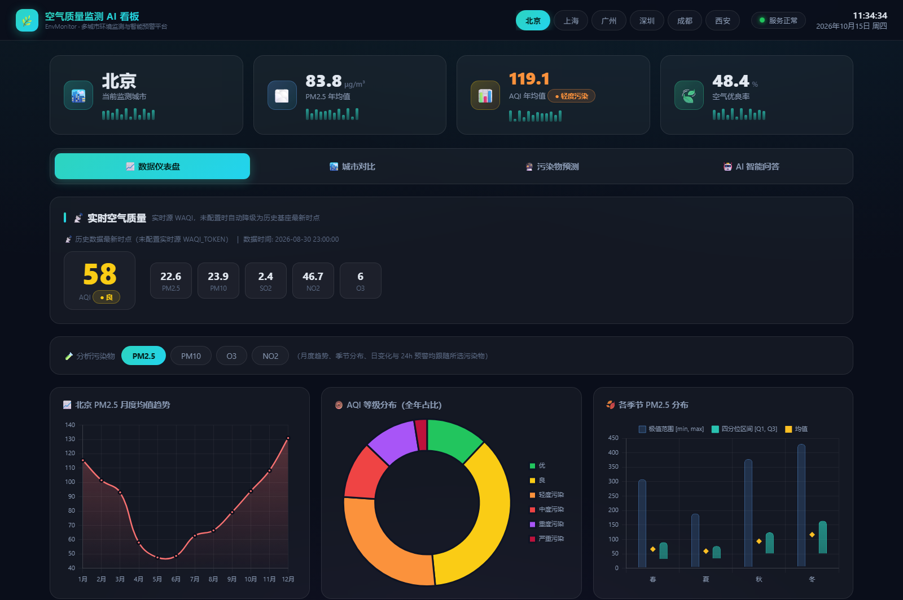
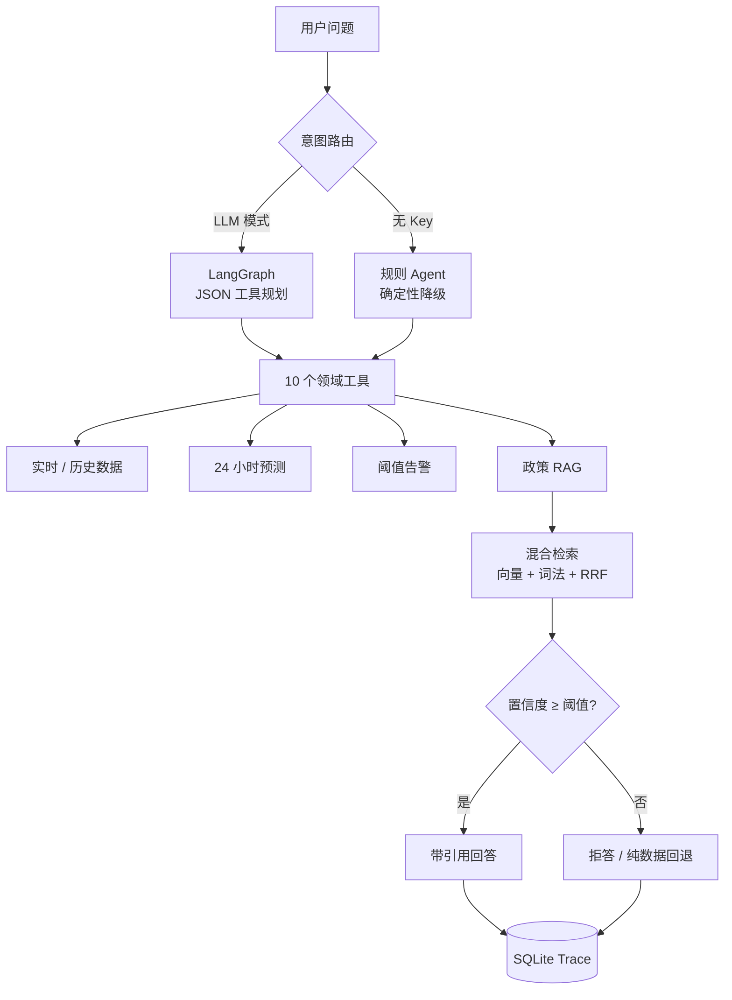

# 多城市空气质量 RAG 问答与预警 Agent · 案例研究

> **这是一个"案例展示仓库"**：放架构、评测方法和结果，不放源码。
> 完整代码为团队私有仓库（含其他成员模块与协作历史），面试时可申请查看 → 见 [CODE_REQUEST.md](CODE_REQUEST.md)。

一个面向"大模型应用"的端到端项目：**FastAPI + LangGraph 编排 10 个领域工具**，把实时数据、24 小时预测、
城市对比、季节分析、相关性分析、阈值告警与政策条款检索统一到一个 Agent 里；政策问答走
**混合检索 + 置信度拒答 + 引用溯源**，没有 LLM Key 时自动降级为**确定性规则 Agent**，保证任何环境都能跑通与回归。

  

## 项目速览

| 项 | 内容 |
|---|---|
| 角色 | 团队项目（5 人）· 技术负责人，负责 **RAG 与评测**：知识库构建、混合检索、拒答、引用、评测、CI |
| 周期 | 2026-08 起版本化（更早的原型无 Git 归档）→ 2026-10 完成评测与工程化 |
| 技术栈 | Python 3.11 · FastAPI · LangGraph · NumPy 向量索引 · BGE-small-zh-v1.5 · SQLite · Docker · GitHub Actions |
| 数据 | 6 城市 × 1 年小时级空气质量，52,704 条记录（CAMS 再分析数据） |
| 能力 | 10 个领域工具 · 政策 RAG · 阈值拒答 · 引用溯源 · 规则降级 · 24h 预测 · 阈值告警 |
| 工程 | 23 个自动化测试 · CI 质量门禁 · 结构化 trace · 可复现评测 |

## 架构

**关键设计**

- **LLM JSON 工具规划**（不是原生 Function Calling）：模型输出结构化调用计划，由代码解析执行，便于校验与回放；
- **规则 Agent 作为可回归基线**：无 Key、无网络也能演示；两套模式共享同一套工具注册表，避免业务逻辑分叉；
- **引用安全分层**：API 层的引用由代码从工具结果**确定性提取**，模型只写正文——实测模型自由文本引用会编造条款；
- **拒答看检索置信度**，不看关键词白名单：阈值随语料漂移，必须可标定。

## 我负责什么

| 范围 | 内容 | 表现 |
|---|---|---|
| 混合检索 | 打分权重、RRF 融合、结构分块策略 | v2 困难集 Recall@5 **0.985** |
| 拒答 | 从"17 词白名单"改为基于原始余弦的阈值判定 | 拒答准确率 0.562 → **0.896** |
| 评测体系 | 重建 v1/v2 评测集、平衡拒答集、dev/holdout 分层 | 见 [docs/evaluation.md](docs/evaluation.md) |
| CI | 质量门禁、覆盖率、向量缓存回放 | CI 配置已提供（运行记录在私有仓库） |
| 代码审查 | 静态审查 + 数据校验 + 30+ 端点实测，修复 7 处缺陷 | 见 [docs/contribution.md](docs/contribution.md) |

> 团队的其他模块（Agent 编排、预测模型、前端、部署）由其他成员完成，本仓库不对其声明 authorship。

## 评测结果（按口径读）

> 下表是 **dev 集**（参与过调参）结果，用来说明工程过程，不代表泛化能力；
> 对外能力结论以独立的 **holdout 集**为准（人工审校后公布）。

| 指标 | 离线 hash（CI 基线） | BGE-small-zh-v1.5（语义路径） |
|---|---:|---:|
| Recall@1 | 0.500 | **0.773** |
| Recall@5 | 0.848 | **0.985** |
| MRR | 0.633 | **0.862** |
| 拒答准确率 | 0.562 | **0.896**（应拒 0.958 / 应答 0.833） |

**工具路由（规则版回归集）**：60/60。这是**回归护栏**——第一轮 80%（12 条 bad case），修复后固化为回归样本，
不代表泛化能力。

**端到端（24 用例，规则版）**：拒答合规率 0.917、OOD 拒答率 1.000（6/6）、
API 层结构化引用正确率 0.708、**结构化幻觉引用 0**。

## 可复现性设计

指标不是"跑一次就结束"的口头承诺，而是设计成可回放的：

| 方式 | 依赖 | 说明 |
|---|---|---|
| 离线 hash 基线 | 仅 NumPy | CI 每次运行，守住"不许退化" |
| **BGE 缓存回放** | 仅 NumPy | 把真实 BGE 运行得到的向量落盘，免 torch 复现语义指标；带语料 sha256 校验（**当前仓库未包含 `bge-v1.npz`，需先生成**） |
| BGE 实跑 | torch + 模型权重 | 首次生成缓存时使用 |

> 缓存回放记录的是"当时的计算结果"，不是重算；语料一变，校验失败并提示重建。

## 演示

- 📺 **Demo 视频**：⚠️ 待补（录制脚本见 [docs/demo-guide.md](docs/demo-guide.md)）
- 🖼️ 界面截图：见上方
- 🎬 3 分钟代码讲解：⚠️ 待补

## 为什么代码私有

1. 团队项目，代码包含其他成员成果，公开需要全体同意；
2. 含 AI 辅助生成的脚手架，公开容易被误读为"全部手工编写"；
3. 私有仓库不降低可验证性：**架构、评测方法、结果、缺陷修复记录都在本仓库**，代码可在面试中按流程查看。

## 文档

| 文档 | 内容 |
|---|---|
| [docs/architecture.md](docs/architecture.md) | 架构、模块边界、关键决策 |
| [docs/evaluation.md](docs/evaluation.md) | 评测方法论：三层评测、指标定义、冻结机制 |
| [docs/results.md](docs/results.md) | 结果与边界说明 |
| [docs/contribution.md](docs/contribution.md) | 团队分工与本人负责范围 |
| [docs/demo-guide.md](docs/demo-guide.md) | 演示视频录制脚本 |
| [CODE_REQUEST.md](CODE_REQUEST.md) | 如何申请查看完整代码 |

---

*本仓库仅含文档与截图，不含项目源码；文档内容与私有仓库的实现保持一致。*
